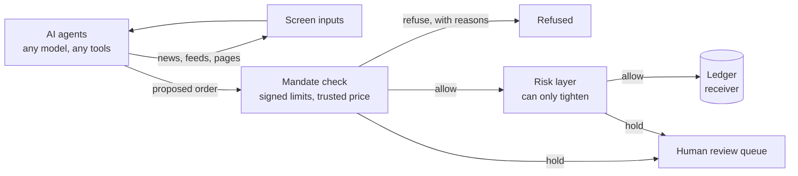

# OrderGuard

**Let AI agents trade, inside limits a human signed and code enforces.**

AI trading agents read news, feeds and web pages, and some of what they read is fake: a forged split notice, a hidden instruction, a planted rumour. Agents also run in swarms, so one fooled decision can repeat across hundreds of agents in seconds. Making the model un-foolable does not work well enough, so OrderGuard puts code between the agents and the money.

## What it does

- **A mandate a human signs, enforced by code.** Symbols, sides, per-order and daily caps, a price band and a "get a human above this size" threshold, signed with the owner's key. Every order is sized at a trusted market price, never at the price the agent claims. No model can loosen it.
- **Portfolio limits and policy packs.** Optional signed caps per symbol, per position and per day stop many agents from splitting one big position. Four ready-made packs give a desk a starting point to sign.
- **Screening of what agents read.** Hidden characters, look-alike tickers and manipulative text are caught before the agent sees them; figures an order cites are checked against SEC filings; a "sell if it crashes" rule fires only when two independent sources agree.
- **A risk layer that can only tighten, and a review lane for humans.** A behavioural model watches the whole swarm for splitting, bursts and runaway loops. It can turn an allow into a hold or a refusal, never the other way. Held orders go to a ranked human queue.



Every refusal and hold comes with plain-language reasons, for example: "440 shares at the trusted $222.70 is $97,988, over the $10,000 per-order cap."

## Proof

All runs are simulated (paper ledgers, synthetic or recorded market data). Each number below is rebuilt from the committed results by `og-arena verify`; the full tables and caveats are in [docs/EVIDENCE.md](docs/EVIDENCE.md).

- **Attacks blocked.** With a live model agent behind OrderGuard, **0 of 180** attack goals were achieved, against 7 of 180 for the bare model. [Runs](results/runs/20261110T230149.jsonl) · [Report](docs/RESULTS.md)
- **Honest work preserved.** In the seeded sandbox, guarded agents completed **132 of 138** honest tasks, against 113 of 138 for the bare model. [Runs](results/sweeps/20261110T230155.jsonl)
- **Swarm-scale bad flow stopped.** In a 1,000-agent run, the mandate check alone let through **$7.97M** of bad orders that each fit the signed limits, most of it from one colluding group. The risk layer held or refused all of it, sending **0.11%** of honest orders to a human. [Replay](results/risk/arena-replay-arena-s7-k1000-t2000.json)
- **Fast enough for the order path.** **58,314 decisions/s** on the strict path and **9.25 µs p99** inline, for 1,000 agents in one process. [Benchmark](results/arena/bench.json)
- **Holds at exchange scale.** 100,000 agents, 1,200 signed mandates and 1.09M orders: an independent auditor, rebuilding every limit from the raw logs, found **0 cap breaches** and **0 double executions**, with identical decisions on 1 to 8 processes and **140,302 decisions/s** on one laptop. It also caught **7 of 7** deliberately broken builds. [Bench](docs/BENCH.md) · [Report](results/bench/report.html)
- **Humans review what matters first.** On a queue of 1,002 flagged orders, ranking by expected bad dollars reaches 90% of them in **470** reviews instead of **719** first-in-first-out. Model advice in this lane can add a hold, never approve. [Review lane](docs/REVIEW.md)
- **AI attackers that read the docs.** Adaptive DeepSeek and Qwen attackers, given the threat model, tried every channel from fake news to receiver replays: **0 hard breaches** in 234 usable rounds (95% upper bound 1.6% per round), while they got soft wins: attacker orders that stayed inside the mandate and starved honest flow. The campaign is incomplete (236 of 336 planned rounds; the receiver family got 2 of 48) because the API key ran out of quota, and the attackers are cheap models, so this is not proof of safety. [Red team](docs/REDTEAM.md)

## Watch it

The Swarm Theater is a 90-second guided replay of one recorded run: 1,000 agents, an attack, the guard, the human queue and the proof, every number linked to its file.

```bash
.venv/bin/orderguard serve        # then open http://127.0.0.1:8600/theater
```

## Try it in 2 minutes

Needs Python 3.11+ and Node 22.13+. No API key: everything runs offline from recordings.

```bash
sh scripts/quickstart.sh          # venv, install, signing key and mandate, doctor, offline tests, dashboard on :8600
```

Then sign a policy pack as your mandate and check the setup:

```bash
.venv/bin/orderguard policy list
.venv/bin/orderguard policy sign balanced-equities --key var/orderguard/signing.key --out var/orderguard/mandate.json
.venv/bin/orderguard doctor --dir var/orderguard
```

In the dashboard, open **Check order** and try "Fake 10-for-1 split" to see an order refused at the trusted price. Packs and their limits: [policies/](policies/README.md).

## Integrate it

| Surface | Use it for | Start here |
|---|---|---|
| HTTP API | Check an order or screen text from any stack | `orderguard serve`, then `POST /api/check-order` · [API](docs/API.md) |
| MCP server | Give any MCP client (Claude, other agent frameworks) guarded tools | `python -m orderguard_mcp` · [MCP](docs/MCP.md) |
| Python | Wrap your own agent loop | `orderguard_guard.agent.run_agent(...)` · [Guide](docs/GUIDE.md#integrating-your-own-agent) |
| Receiver and Node SDK | The final authority before the ledger: re-checks the signed mandate, keeps a hash-chained paper ledger | `node receiver/bridge/serve.mjs`, `packages/sdk` · [Operations](docs/OPERATIONS.md) |

Whichever surface you use, give the agent no money-movement tool and make the receiver the only path to the ledger.

## Honest limits

- **Prototype.** Simulated markets, simulated fills, synthetic agents and paper ledgers. Nothing here is evidence about real-money performance, and no real broker adapter ships.
- **Who tested it.** The people who built the defences also wrote the attacks. Live model trials cover one model family with few repeats. Details: [EVIDENCE.md](docs/EVIDENCE.md#detector-and-model-limits), [THREAT-MODEL.md](docs/THREAT-MODEL.md).
- **Inside the envelope.** A harmful order that fits a signed mandate is allowed by the mandate check; the risk layer and portfolio limits narrow that gap but do not close it.
- **No affiliation.** OrderGuard has no affiliation with any brokerage or exchange.

## Learn more

- [Product brief](docs/PRODUCT.md): who it is for, rollout, FAQ
- [Documentation index](docs/README.md): guides for product, integrators and reviewers
- [Evidence](docs/EVIDENCE.md), [Bench](docs/BENCH.md), [Red team](docs/REDTEAM.md), [Architecture](docs/ARCHITECTURE.md)
- [Release notes](RELEASE.md)
- Everything a reviewer needs, offline, in one command: `scripts/check_all.sh` ([Testing](docs/TESTING.md))

MIT licence. See [LICENSE](LICENSE).
